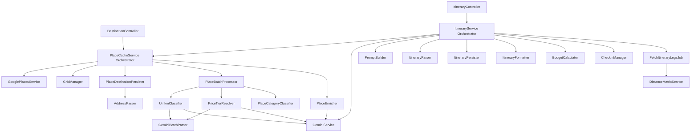

# Savelo — Budget-First Travel Planner API

**Status Proyek:** `Completed Hackathon Prototype` (Backend API)

Savelo adalah backend API perencanaan perjalanan berbasis budget (*budget-first travel planner*) yang dibangun dengan **Laravel 13**, **MySQL**, **Google Places API v1**, **Google Distance Matrix API**, dan **Gemini AI**. Sistem ini secara otomatis menyusun 3 varian itinerary (*Hemat*, *Seimbang*, dan *Experience*) sesuai budget pengguna, menyajikan peta eksplorasi destinasi (*Discovery Map*), menghasilkan *AI MicroStory* per tempat, serta menyediakan mekanisme GPS check-in (radius 100 meter) dengan gamifikasi *EcoPoints + CulturePoints = PathPoints*.

---

## Fitur Utama yang Diimplementasikan

- **Autentikasi & Keamanan Akun:** Registrasi berbasis OTP email (berlaku 10 menit), login/logout berbasis Laravel Sanctum Bearer token, reset password via OTP, serta login OAuth Google via Laravel Socialite.
- **Two-Layer Spatial Place Caching & Discovery Map:** Sinkronisasi destinasi kota (`GET /api/destinations`), peta pin kategorikal (`umkm`, `iconic`, `heritage`, `hidden_gem`, `hotel`, `transit`), dan detail destinasi beserta tempat sekitar dalam radius 3 km + *AI MicroStory*.
- **Budget-First Itinerary Generator:** Menghasilkan 3 varian itinerary (*Hemat*, *Seimbang*, *Experience*) berbasis kandidat terkurasi dari database lokal, lengkap dengan kalkulasi jarak & durasi antar destinasi secara asynchronous melalui `FetchItineraryLegsJob`.
- **Itinerary Management & Live Cost Recalculation:** Melihat riwayat request, detail itinerary, rencana harian, serta mengganti destinasi atau memperbarui status item (`pending`/`completed`) dengan kalkulasi ulang biaya otomatis.
- **GPS Check-in & Gamifikasi PathPoints:** Validasi jarak pengguna terhadap destinasi (radius 100 m), preview moda transportasi dengan laju `eco_points_rate` & `co2_per_km`, dan pemberian poin (`EcoPoints + CulturePoints = PathPoints`).
- **Destinasi Favorit:** Menyimpan, melihat, dan menghapus destinasi favorit pengguna.

---

## Arsitektur Backend Terbaru

Service inti telah di-refactor dari dua *God Service* (`PlaceCacheService` 884 baris dan `ItineraryService` 1.039 baris) menjadi orchestrator tipis dan class modular berbasis **Single Responsibility Principle (SRP)** dengan *Constructor Dependency Injection*:



### Struktur Direktori Service (`app/Services/` & `app/Jobs/`)

```text
app/
├── Jobs/
│   └── FetchItineraryLegsJob.php          (79 baris)  — Hitung jarak & durasi antar item via Distance Matrix
└── Services/
    ├── PlaceCacheService.php              (254 baris) — Orchestrator layer kota, detail 3km & cache lock
    ├── PlaceCache/
    │   ├── GridManager.php                (62 baris)  — Kuantisasi koordinat grid 0.02° & Area TTL 30 hari
    │   ├── AddressParser.php              (40 baris)  — Ekstraksi country_code & city dari addressComponents
    │   ├── PlaceCategoryClassifier.php    (177 baris) — Mapping kategori, rule UMKM, heritage/iconic/hidden_gem
    │   ├── PriceTierResolver.php          (126 baris) — Price tier Google/AI, fallback kategori & priceTierRange
    │   ├── UmkmClassifier.php             (70 baris)  — Prompt batch klasifikasi UMKM lokal via Gemini
    │   ├── PlaceEnricher.php              (59 baris)  — Generasi AI MicroStory destinasi
    │   ├── PlaceBatchProcessor.php        (68 baris)  — Orkestrasi batch klasifikasi UMKM & price tier
    │   └── PlaceDestinationPersister.php  (156 baris) — Upsert destinasi & query Haversine lokal
    ├── ItineraryService.php               (364 baris) — Orchestrator generate, history, update & check-in
    ├── Itinerary/
    │   ├── PromptBuilder.php              (142 baris) — Seleksi kandidat & prompt 3 varian budget
    │   ├── ItineraryParser.php            (83 baris)  — Parsing JSON Gemini, normalisasi varian & rekomendasi
    │   ├── BudgetCalculator.php           (68 baris)  — Estimasi biaya deterministik, delta status & snapshot
    │   ├── ItineraryPersister.php         (209 baris) — Transaksi DB simpan varian & update item
    │   ├── ItineraryFormatter.php         (267 baris) — Formatting payload API request, card, day & item
    │   └── CheckinManager.php             (152 baris) — Validasi radius Haversine 100m & transaksi PathPoints
    ├── Gemini/
    │   ├── GeminiService.php              (77 baris)  — HTTP client Gemini generateContent
    │   └── GeminiBatchParser.php          (46 baris)  — Parser batch AI + threshold confidence score (< 70%)
    ├── GooglePlacesService.php            (99 baris)  — HTTP client Google Places API v1
    ├── DistanceMatrixService.php          (56 baris)  — HTTP client Google Distance Matrix API
    └── FirebaseClient.php                 (28 baris)  — Wrapper Kreait Firebase Factory
```

---

## Key Engineering Decisions

### 1. Spatial Grid Area Caching (`0.02°` Grid + `3.000 m` Detail Radius)
- **Masalah:** Memanggil Google Places `searchNearby` untuk setiap permintaan detail destinasi akan cepat menghabiskan kuota API dan meningkatkan latensi respons.
- **Keputusan:** `GridManager` mengkuantisasi koordinat geografis menjadi indeks sel grid integer melalui `(int) floor($coord / 0.02)` (resolusi `0.02°` ≈ 2,2 km) dan menyimpannya pada tabel `areas` (`UNIQUE(grid_lat, grid_lng)`) dengan TTL 30 hari. Pencarian kota menggunakan `Cache::lock("city_fetch_{$slug}", 60)` untuk mencegah *cache stampede*, sementara tempat sekitar dalam radius `3000` meter diambil dari database lokal via query Haversine di `PlaceDestinationPersister::getNearbyFromDb()`.
- **Trade-off:** Titik yang berdekatan namun berada di sisi berlawanan batas grid dapat memicu fetch ulang sel bertetangga, dan sel derajat tetap memiliki ukuran fisik yang menyusut jauh dari ekuator (namun sangat memadai untuk cakupan wilayah Indonesia).

### 2. Penanganan Data Kosong AI via Confidence Score & Deterministic Server-Side Fallback
- **Masalah:** Respons Google Places API sering tidak menyertakan `priceLevel` maupun penanda UMKM lokal, sementara estimasi dari LLM bisa tidak konsisten atau memiliki tingkat keyakinan rendah.
- **Keputusan:** `UmkmClassifier` dan `PriceTierResolver` meminta hasil batch beserta *confidence score* dalam format `place_id|value|confidence_score` dari Gemini AI. `GeminiBatchParser` memfilter prediksi dengan *confidence* `< 70%` menjadi `null`, lalu server menjatuhkan ke *deterministic fallback* berjenjang:
  1. **Klasifikasi UMKM:** Jika AI mengembalikan `null`, `PlaceCategoryClassifier::classifyUmkmByRules()` mengevaluasi nama tempat terhadap daftar blacklist franchise besar dan whitelist kata kunci UMKM lokal.
  2. **Price Tier Kosong:** Jika Google `priceLevel` dan hasil AI sama-sama kosong/ditolak, `PriceTierResolver::categoryFallbackTier()` memetakan kategori ke tier tetap (`umkm`/`taman` → `budget`, `wisata`/`museum`/`restoran`/`cafe`/`belanja` → `mid`, `hotel` → `premium`).
  3. **Alokasi Budget:** `BudgetCalculator::estimateCost()` menghitung estimasi biaya secara deterministik di server berdasarkan batas bawah (`min`) dari `PriceTierResolver::priceTierRange()` dikalikan `num_people`.
- **Trade-off:** Mengorbankan variasi harga per venue individual agar kalkulasi biaya itinerary tetap deterministik, dapat diaudit, dan bebas halusinasi angka dari LLM.

### 3. Prototype vs Production Trade-off pada Caching MySQL
- **Masalah:** Kebutuhan menjaga kecepatan respons dan efisiensi biaya/kuota Google Places API selama pengembangan prototipe hackathon.
- **Keputusan:** Data tempat hasil Google Places API disimpan sementara di tabel MySQL (`areas` & `destinations`) dengan masa berlaku 30 hari.
- **Trade-off:** Pendekatan ini sangat efektif untuk demonstrasi dan efisiensi kuota pada tahap **Completed Hackathon Prototype**, namun untuk rilis produksi penuh harus disesuaikan agar patuh terhadap *Google Maps Platform Terms of Service* (membatasi penyimpanan persisten hanya pada `place_id` dan menyegarkan atribut tempat sesuai kebijakan Google).

---

## Daftar Endpoint API (24 Route Aktif)

Seluruh endpoint di bawah terverifikasi melalui `php artisan route:list --except-vendor` (prefix `/api`, response standar melalui `App\Support\ApiResponse`).

| Method | Path | Middleware | Deskripsi |
|---|---|---|---|
| `GET\|HEAD` | `/` | `web` | Halaman welcome Laravel default |
| `POST` | `/api/auth/register` | `throttle:auth` | Registrasi tahap 1: kirim OTP 6 digit ke email |
| `POST` | `/api/auth/register/verify` | `throttle:auth` | Registrasi tahap 2: verifikasi OTP & terbitkan Sanctum token (`201`) |
| `POST` | `/api/auth/login` | `throttle:auth` | Login email & password, mengembalikan Sanctum Bearer token |
| `POST` | `/api/auth/logout` | `auth:sanctum` | Mencabut Sanctum access token aktif saat ini |
| `POST` | `/api/auth/forgot-password` | `throttle:auth` | Kirim OTP reset password ke email terdaftar |
| `POST` | `/api/auth/forgot-password/reset` | `throttle:auth` | Verifikasi OTP, reset password, dan cabut token lama |
| `GET\|HEAD` | `/api/auth/google` | `api` | Redirect ke halaman OAuth Google (stateless Socialite) |
| `GET\|HEAD` | `/api/auth/google/callback` | `api` | Callback OAuth Google, upsert user & terbitkan Sanctum token |
| `GET\|HEAD` | `/api/destinations` | `auth:sanctum`, `throttle:api` | Ambil daftar destinasi kota (`?city=...&category=...`) |
| `GET\|HEAD` | `/api/destinations/map` | `auth:sanctum`, `throttle:api` | Ambil pin ringan Discovery Map (`?city=...&category=...`) |
| `GET\|HEAD` | `/api/destinations/{placeId}` | `auth:sanctum`, `throttle:api` | Detail destinasi, *AI MicroStory*, dan trigger nearby cache 3 km |
| `GET\|HEAD` | `/api/favorites` | `auth:sanctum`, `throttle:api` | Daftar destinasi favorit user terautentikasi |
| `POST` | `/api/favorites` | `auth:sanctum`, `throttle:api` | Tambah destinasi ke daftar favorit |
| `DELETE` | `/api/favorites/{destinationId}` | `auth:sanctum`, `throttle:api` | Hapus destinasi dari daftar favorit |
| `POST` | `/api/itineraries/generate` | `auth:sanctum`, `throttle:api`, `throttle:itinerary-generate` | Generate 3 varian itinerary + dispatch `FetchItineraryLegsJob` |
| `GET\|HEAD` | `/api/itineraries/requests/{requestId}` | `auth:sanctum`, `throttle:api` | Riwayat hasil generate berdasarkan `requestId` milik user |
| `GET\|HEAD` | `/api/itineraries/{itineraryId}` | `auth:sanctum`, `throttle:api` | Detail lengkap 1 varian itinerary beserta seluruh hari & leg |
| `GET\|HEAD` | `/api/itineraries/{itineraryId}/days/{dayNumber}` | `auth:sanctum`, `throttle:api` | Detail rencana perjalanan untuk satu hari tertentu |
| `PATCH` | `/api/itineraries/{itineraryId}/{itemId}` | `auth:sanctum`, `throttle:api` | Swap destinasi (`place_id`) dan/atau update `status` item + hitung ulang biaya |
| `POST` | `/api/itineraries/{itineraryId}/items/{itemId}/check-location` | `auth:sanctum`, `throttle:api` | Cek jarak GPS pengguna terhadap destinasi (radius valid 100 m) |
| `GET\|HEAD` | `/api/itineraries/{itineraryId}/items/{itemId}/checkin-preview` | `auth:sanctum`, `throttle:api` | Preview poin budaya, jarak leg, dan daftar moda transportasi |
| `PATCH` | `/api/itineraries/{itineraryId}/items/{itemId}/checkin` | `auth:sanctum`, `throttle:api` | Selesaikan check-in item & berikan `EcoPoints + CulturePoints = PathPoints` |
| `POST` | `/api/itineraries/{itineraryId}/smart-swaps` | `auth:sanctum`, `throttle:api`, `throttle:smart-swaps` | **Planned / Not Implemented (`501`)** — Mengembalikan respons `501 Not Implemented` terstruktur pada prototipe ini |

---

## Local Setup & Automated Testing

### Prasyarat
- PHP `^8.3` (ekstensi `pdo_mysql`, `pdo_sqlite`, `openssl`, `mbstring`)
- Composer & Node.js / npm
- MySQL (untuk environment lokal sesuai `.env.example`)

### Instalasi Lokal

```bash
# 1. Install dependencies PHP & JS, salin .env, generate key, dan migrasi
composer install
cp .env.example .env
php artisan key:generate

# 2. Sesuaikan konfigurasi DB MySQL, Google API, Gemini API, dan Mail di .env
#    (DB_DATABASE=savelo, GOOGLE_API_KEY, GEMINI_API_KEY, GEMINI_MODEL=gemini-2.5-flash)

# 3. Jalankan migrasi & seeder utama (AreaSeeder, UserSeeder, TransportModeSeeder)
php artisan migrate --seed

# 4. Build asset frontend & jalankan server pengembangan
npm install
npm run build
php artisan serve
```

### Menjalankan Automated Tests & Code Style

Konfigurasi di `phpunit.xml` menggunakan **SQLite `:memory:`**, cache `array`, dan queue `sync` sehingga test tidak pernah menyentuh database development MySQL. Seluruh panggilan HTTP eksternal (Google Places, Distance Matrix, Gemini AI) dijaga dengan `Http::preventStrayRequests()` secara global di `tests/TestCase.php` dan dimock via `Http::fake()`, `Mail::fake()`, serta mock `Socialite`.

```bash
# Jalankan seluruh Unit & Feature tests (0 real API calls, 0 skipped)
php artisan test --compact

# Cek & rapikan formatting kode PHP menggunakan Laravel Pint
php vendor/bin/pint --format agent
```
